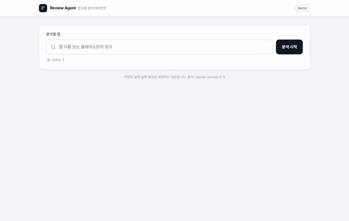

# 앱 리뷰 분석 에이전트



## 1. 배경

앱 리뷰에는 사용자가 겪는 문제와 요청이 그대로 담겨 있다. 하지만 양이 많고 형식이 제각각이라 사람이 일일이 읽고 정리하기 어렵다.

LLM에 분석을 맡기면 빠르게 요약할 수 있다. 실제로 "앱 리뷰를 분석해서 개선안을 제시해줘"라는 지침 한 줄만으로도 형식이 갖춰진 보고서가 나왔다. 하지만 앱으로 고칠 수 없는 내용이 섞여 있었고, 개선안의 근거나 우선순위를 정한 기준도 없었다. 개선 방향을 정하는 데 쓰려면 근거가 분명하고 우선순위를 판단할 수 있는 결과가 필요하다.

따라서 LLM의 분석 결과를 실제 의사결정에 쓸 수 있는 형태로 만드는 것을 목표로 했다.

## 2. 결과물 평가 기준

1. 분석이 앱 관련 리뷰에만 근거하는가
2. 개선안마다 근거가 있는가
3. 읽는 사람이 한눈에 파악할 수 있는가

## 3. 에이전트 구조

```
     최신 리뷰 100개
        ↓
     [1단계] 분류 에이전트
        앱의 기능·화면·정책에 대한 리뷰만 선별
        ↓
┌──▶ [2단계] 분석 에이전트
│       카테고리 정리, 개선안 작성
│       ↓
└─── [하네스] 자동 검증
        근거 리뷰 연결, 필수 항목, 숫자 일치 확인 (기준 미달 시 이유와 함께 반려)
        ↓ 통과
     최종 보고서
        검증을 통과한 데이터로 개선안 부분 작성
```

## 4. 개선 과정

모든 버전은 카카오 T의 플레이스토어 최신 리뷰 100개([reviews.xlsx](review_agent/reviews.xlsx))로 같은 조건에서 실행했다.

| 버전 | 발견한 문제 | 개선 내용 |
|---|---|---|
| v1 | - | 지침 한 줄로 시작 |
| v2 | 앱과 무관한 내용이 개선안에 들어감 | 리뷰 분류 단계 추가 |
| v3 | 분류 기준이 모호함, 개선안에 근거가 없음 | 분류 기준 구체화, 개선안 작성 기준, 자동 검증 |
| v4 | 같은 문제가 잘게 나뉘어 핵심이 한눈에 안 보임 | 카테고리로 묶기, 보고서 구성 정리 |
| v5 | 우선순위 기준이 난이도 하나뿐이라 문제의 크기가 반영되지 않음 | 우선순위 기준 변경, 경쟁 앱 비교 |

### v1

- **지침**: "앱 리뷰를 분석해서 앱 개선안을 제시해줘." ([analyze.txt](review_agent/prompts/v1/analyze.txt))

### v2

- **발견한 문제**: 분석에 기사 서비스 품질(불친절, 과도한 대화)과 기타 서비스(바이크 배터리 방치, 퀵 기사 관리) 항목이 포함됐다.
- **리뷰 분류 단계 추가**: 리뷰가 앱에 관한 평가인지 먼저 분류하고, 앱에 대한 평가만 분석하게 했다.
- 지침: [filter.txt](review_agent/prompts/v2/filter.txt) · [analyze.txt](review_agent/prompts/v2/analyze.txt)

### v3

- **발견한 문제 1**: 분류 기준이 모호해 부가 서비스 내용이 개선안에 남았고, 분석 에이전트가 "일부 리뷰는 앱과 무관하거나 모호하다"고 따로 적을 만큼 애매한 리뷰가 통과됐다.
- **발견한 문제 2**: 개선안에 근거 리뷰가 연결되지 않았고, 기대 효과와 우선순위 기준이 없었다.
- **분류 기준 구체화**: 판단 기준을 "이 리뷰를 근거로 앱의 기능, 화면, 정책을 고칠 수 있는가"로 정하고, 애매한 경우는 예시로 정했다. (예: "기사가 취소해도 불이익이 없다"는 앱의 취소 정책 불만이므로 O, "기사가 불친절했다"는 기사 개인의 태도이므로 X)
- **개선안 작성 기준**: 개선안마다 근거 리뷰, 개선 방법, 기대 효과, 난이도(하·중·상)와 이유를 쓰고, 난이도가 낮은 순으로 정렬하게 했다.
- **자동 검증**: 필수 항목이 비었는지, 근거 리뷰가 실제 분석 대상인지, 정렬이 맞는지 검사하고, 기준에 못 미치면 이유와 함께 반려하게 했다.
- 지침: [filter.txt](review_agent/prompts/v3/filter.txt) · [analyze.txt](review_agent/prompts/v3/analyze.txt)

### v4

- **발견한 문제**: 같은 원인의 문제가 잘게 나뉘어 개선안이 너무 많았고, 한 표에 모든 내용이 들어가 핵심을 파악하기 어려웠다.
- **카테고리로 묶기**: 같은 원인의 문제를 카테고리로 묶고, 개선안도 카테고리 단위로 쓰게 해 개선안 수를 줄였다.
- **보고서 구성 정리**: 요약 → 카테고리별 문제점 → 개선안 우선순위 순서로 정하고, 개선안은 요약 표를 먼저 보여준 뒤 상세 내용을 아래에 두었다.
- 지침: [filter.txt](review_agent/prompts/v4/filter.txt) · [analyze.txt](review_agent/prompts/v4/analyze.txt)

### v5

- **발견한 문제**: 우선순위 기준이 난이도 하나뿐이라, 많은 사용자가 겪는 문제라도 해결이 어려우면 뒤로 밀렸다.
- **우선순위 기준 변경**: 문제의 영향도(근거 리뷰 수와 피해의 심각도)와 해결 난이도를 함께 보고, ① 바로 실행 → ② 중장기 과제 → ③ 여유 있을 때 → ④ 보류로 나누게 했다. 심각도는 리뷰에 적힌 피해(이용 포기, 금전 손실)를 근거로만 판단하게 하고 하네스가 확인한다.
- **경쟁 앱 비교**: 같은 기간 리뷰를 앱마다 같은 방식으로 분석하고, 문제 카테고리를 공통으로 묶어 앱별 언급 비율을 비교하는 보고서를 추가했다.
- 지침: [filter.txt](review_agent/prompts/v5/filter.txt) · [analyze.txt](review_agent/prompts/v5/analyze.txt) · [compare.txt](review_agent/prompts/v5/compare.txt)

## 5. 결과

### LLM 평가 결과

| 평가 기준 | 지표 | v1 | v2 | v3 | v4 | v5 |
|---|---|---|---|---|---|---|
| 분석이 앱 관련 리뷰에만 근거하는가 | 관련성 | 88% | 97% | 100% | 100% | 100% |
| 개선안마다 근거가 있는가 | 근거 있는 개선안 비율 | 0% | 3% | 100% | 100% | 100% |
| 읽는 사람이 한눈에 파악할 수 있는가 | 질문 응답률 | 33% | 67% | 100% | 100% | 100% |
| | 쌍대 비교 선택률 (v3 vs v4) | - | - | 0% | 100% | - |

모든 지표는 Claude가 판정 기준에 따라 판정했다. ([평가 기준](review_agent/eval_prompts/) · [전체 결과](review_agent/outputs/eval/summary.md))

### 평가 방식

- **관련성**: 보고서에서 개선안을 하나씩 추출해 앱의 기능·화면·정책으로 해결할 수 있는 개선안인지 판정했다.
- **근거 있는 개선안 비율**: 개선안에 연결된 리뷰의 원문을 확인해 실제로 그 개선안이 다루는 문제를 말하는지 판정했다.
- **질문 응답률**: "가장 먼저 해야 할 개선안과 그 이유", "가장 많이 지적된 문제와 리뷰 수" 등 의사결정에 필요한 질문 6개를 정하고, 보고서에 적힌 정보만으로 답할 수 있는지 판정했다.
- **쌍대 비교 선택률**: v3와 v4 보고서를 나란히 제시해, 핵심 문제와 우선순위를 더 빨리 파악할 수 있는 보고서를 고르게 했다. 제시 순서에 따른 편향을 줄이기 위해 순서를 번갈아 바꿔 10회 반복했다.

### 결과 해석

- 분류 단계를 추가한 v2에서 관련성이 높아졌고, 분류 기준을 강화한 v3에서도 관련성이 소폭 올랐다.
- 근거와 우선순위 기준을 정한 v3부터 모든 개선안이 근거를 갖추고 의사결정 질문에 답할 수 있게 됐다.
- v3와 v4는 정보의 유무에서는 차이가 없었지만, 두 보고서를 비교했을 때 10번 모두 v4가 핵심을 더 빨리 파악할 수 있는 보고서로 선택됐다.
- v5는 우선순위 기준을 바꾸고 경쟁 앱 비교를 추가한 뒤에도 세 지표가 유지됐다.

### 경쟁 앱 비교 (v5)

| 공통 카테고리 | 카카오 T | 우버 | 차이 |
|---|---|---|---|
| 배차·호출 지연 | 29% | 16% | +13%p |
| 위치·길안내 오류 | 14% | 11% | +3%p |
| 가입·로그인 절차 오류 | 6% | 13% | -7%p |

2026-09-24 ~ 10-23 리뷰 기준이며, 비율은 그 문제를 언급한 리뷰 수 ÷ 앱 관련 리뷰 수(카카오 T 101개, 우버 45개)다. ([전체 비교 보고서](review_agent/outputs/compare/2026-09-24_2026-10-23/comparison_taxi_vs_ubercab.md))

### 한계

- LLM 판정이라 실행에 따라 수치가 다소 달라질 수 있지만, 버전 간 경향은 반복 실행에서도 같았다.
- v4와 v5의 쌍대 비교에서는 평가자가 제시 순서상 뒤에 놓인 보고서를 주로 골라, 결과에 넣지 않았다.

<details>
<summary>버전별 보고서와 작업 기록</summary>

| 버전 | 보고서 | 작업 기록 |
|---|---|---|
| v1 | [report.md](review_agent/outputs/v1/report.md) | [trace.md](review_agent/outputs/v1/trace.md) |
| v2 | [report.md](review_agent/outputs/v2/report.md) | [trace.md](review_agent/outputs/v2/trace.md) |
| v3 | [report.md](review_agent/outputs/v3/report.md) | [trace.md](review_agent/outputs/v3/trace.md) |
| v4 | [report.md](review_agent/outputs/v4/report.md) | [trace.md](review_agent/outputs/v4/trace.md) |
| v5 | [report.md](review_agent/outputs/v5/report.md) · [comparison_taxi_vs_ubercab.md](review_agent/outputs/compare/2026-09-24_2026-10-23/comparison_taxi_vs_ubercab.md) | [trace.md](review_agent/outputs/v5/trace.md) |

작업 기록에는 에이전트가 쓴 도구와 반려된 이유가 남아 있다. 분류 결과(O/X와 이유)는 각 버전 폴더의 `filter.xlsx`에 있다.

</details>

<details>
<summary>실행 방법</summary>

```bash
pip install anthropic google-play-scraper pandas openpyxl
```

환경 변수 `ANTHROPIC_API_KEY`를 설정한 뒤 `review_agent/` 폴더에서 실행한다.

```bash
python run_prompt.py collect "카카오 T"              # 리뷰 수집 (최신 100개)
python run_prompt.py v5                              # 분류 → 분석 → 검증 → 보고서
python run_prompt.py compare "우버 택시" "타다"       # 경쟁 앱 비교 (기본 최근 30일)
python evaluate.py v1 v2 v3 v4                       # 품질 평가
```

- `compare`는 `--from 2026-09-01 --to 2026-09-30`으로 기간을, `--base`로 기준 앱을 바꿀 수 있다.
- 앱당 리뷰가 200개를 넘으면 기간 전체에서 고르게 200개를 쓰고, 10개 미만이면 비교에서 뺀다.

</details>

<details>
<summary>폴더 구조</summary>

```
demo/                  데모 페이지와 GIF (build_data.py: 실행 결과로 데이터 채우기, record_gif.py: GIF 녹화)
review_agent/
├── run_prompt.py      에이전트 실행, 하네스(검증·보고서 작성), 경쟁 앱 비교
├── evaluate.py        LLM 평가
├── reviews.xlsx       카카오 T 리뷰 100개
├── prompts/v1 ~ v5/   버전별 지침
├── eval_prompts/      평가 기준
└── outputs/
    ├── v1 ~ v5/       버전별 보고서, 작업 기록, 분류 결과
    ├── eval/          평가 결과
    └── compare/       경쟁 앱 비교 결과
```

</details>
